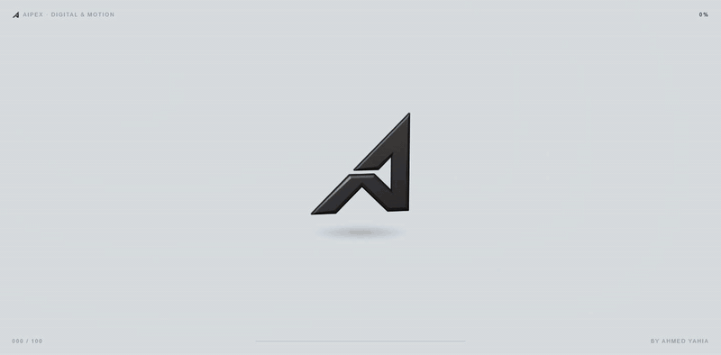
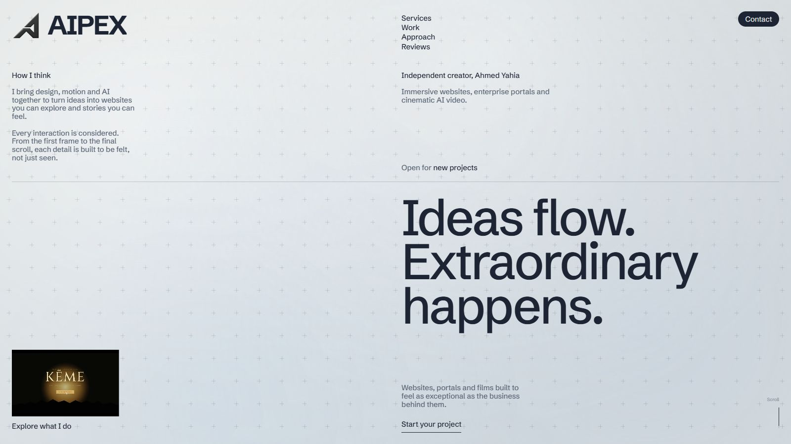
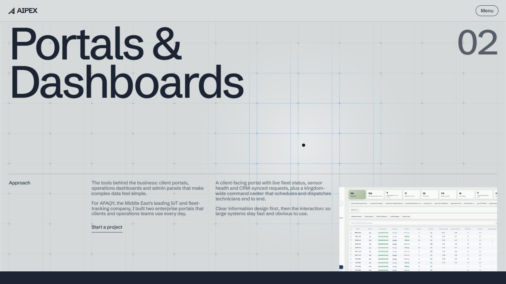
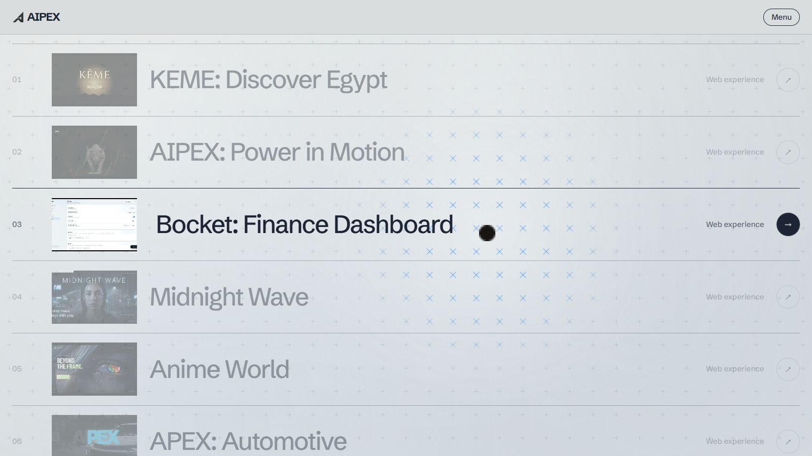
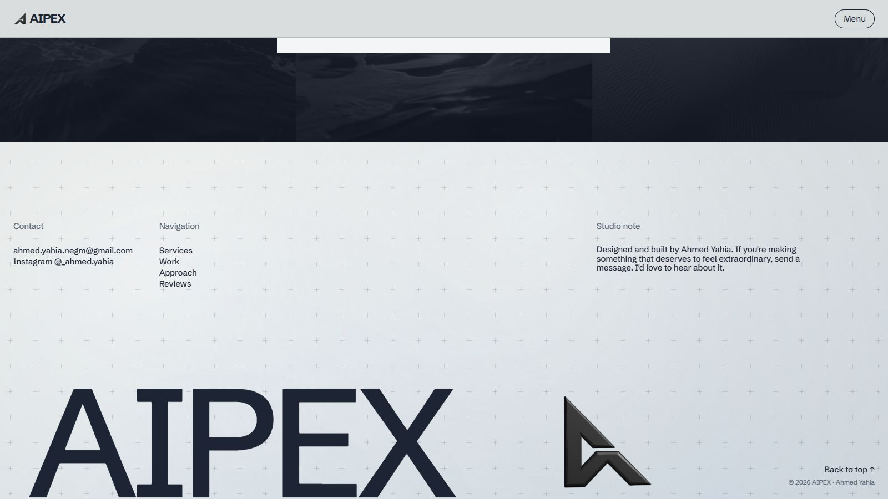

# AIPEX

Portfolio of **Ahmed Yahia**, web designer and digital and motion creator.

**Live site: https://aipexwebstudio.web.app**



A studio style portfolio built without a framework: plain HTML, CSS and JavaScript, animated with GSAP, with content, analytics and an admin panel on Firebase. It is made to feel crafted rather than templated, and to stay smooth on ordinary laptops.

## Highlights

- **A logo that flies into place.** The opening shows the 3D mark rolling on the site's own background. It slows to face front, arcs across the screen to the exact spot of the header logo and lands on it, a ripple runs through the page while the opening background melts away, and the headline rises around it. On phones the mark docks into the header instead.
- **Stacked full screen pages.** Three pages (Web, Portals, Motion) are sticky layers. As the next one slides over, the previous one scales back, lifts and dims, driven by ScrollTrigger.
- **Living backgrounds, built to be cheap.** `bg-fx.js` is a small engine with five effects: registration marks, silk lines, streaks, a blueprint grid and pointer parallax. Textures are pre-rendered WebP images and motion is CSS, so only a small masked window follows the pointer. A frame time guard switches the effects off on slow machines.
- **3D logo without WebGL.** The rolling mark is a thin plate made of stacked CSS 3D slices: coloured front and back faces with a dark wall between them.
- **Two tone colour system.** Two grounds, light and navy, alternate down the page. Each section takes its variables from a single class.
- **Firebase backend.** Hosting with a cache strategy, Realtime Database for the contact form, analytics and portfolio content added from the admin, and locked rules: only the owner can read data, and visitors can only add entries that pass validation.
- **Admin panel** (`admin.html`). Google sign in, manage websites, films and reviews, and read contact messages.
- **Respects the visitor.** `prefers-reduced-motion` skips the opening and the 3D spin, and if scripts fail the page falls back to a static layout.

## Screenshots

| | |
|---|---|
|  |  |
|  |  |

## Tech

HTML, CSS (custom properties, grid, clip-path, 3D transforms), vanilla JavaScript, GSAP and ScrollTrigger, Lenis smooth scrolling, and Firebase (Hosting, Realtime Database, Authentication, Analytics).

## Structure

```
index.html            page markup
site.css              all styles: colour grounds, stacked pages, 3D logo, backgrounds
site.js               motion, content rendering, menu, contact form
bg-fx.js              interactive background engine
firebase-config.js    Firebase settings (placeholders in this repo)
firebase-analytics.js bridge to the Realtime Database
admin.html / admin.js admin panel
database.rules.json   Realtime Database rules
storage.rules         Storage rules
firebase.json         Hosting config and cache headers
assets/               brand marks, effect textures, vendor libraries, case study images, poster stills
```

## Run it locally

```bash
npx serve .
```

Then open the address it prints. The project videos are not part of this repository because of their size, so the work tiles show their poster stills only. The Firebase settings are placeholders, so the analytics, the contact form and the admin stay idle until you add the settings of your own Firebase project to `firebase-config.js` and your user id to the rules and `admin.js`.

## Notes

Copyright 2026 Ahmed Yahia. The source is public so the work can be reviewed. Please do not reuse the design, the brand or the imagery without permission.
